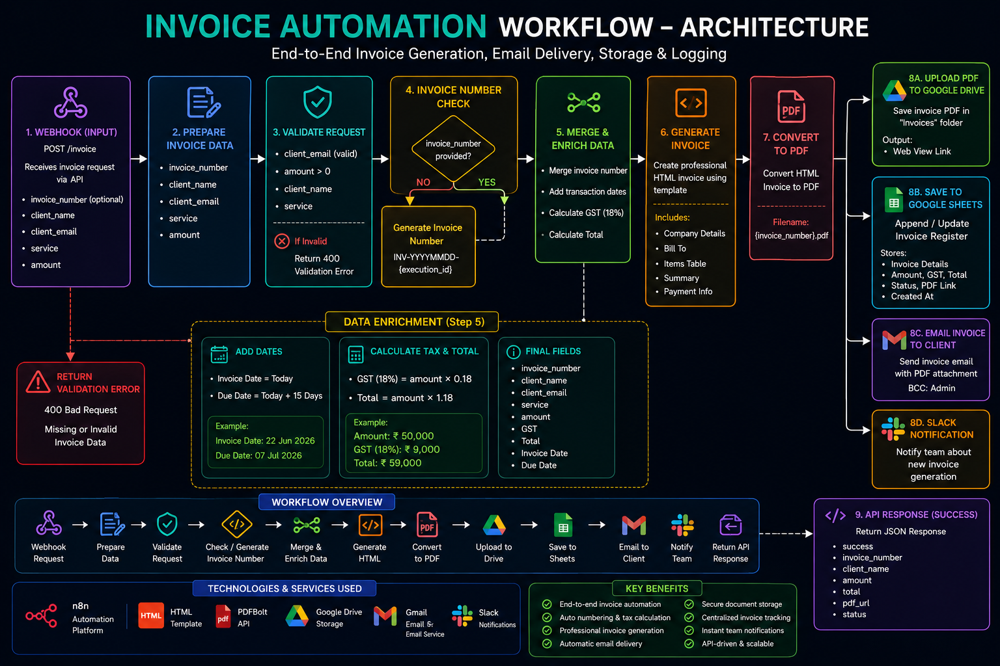

# Invoice PDF Generation & Delivery — Architecture

**Validate an invoice request, reserve a record, calculate a template total, render/store a PDF, and email it to the submitted client address.**

## 1. Workflow at a glance

```mermaid
flowchart LR
    A["1. INVOICE REQUEST<br/>ID, client, service,<br/>email, amount"] --> B["2. VALIDATE<br/>Formats + amount limits"]
    B -->|invalid| X["HTTP 400<br/>Invalid request"]
    B -->|valid| C["3. DUPLICATE LOOKUP<br/>Google Sheets"]
    C --> D{"Already exists?"}
    D -->|yes| E["HTTP 200<br/>Duplicate; no second email"]
    D -->|no| F["HTTP 202 ACCEPTED<br/>Processing continues"]
    F --> G["4. NUMBER + DATES<br/>Date + execution ID;<br/>15-day due date"]
    G --> H["5. TAX / TOTAL<br/>INR + fixed 18% GST"]
    H --> I["6. RESERVE RECORD<br/>Google Sheets"]
    I --> J["7. HTML → PDF<br/>Escape text + validate PDF"]
    J --> K["8. STORE FILE<br/>Google Drive"]
    K --> L["9. EMAIL INVOICE<br/>Submitted client email"]
    L --> M{"Email and status update?"}
    M -->|sent| N["SENT<br/>Update row + Slack"]
    M -->|failed| O["MANUAL CHECK<br/>Mark failure + alert"]
    classDef input fill:#f3f1ff,stroke:#7256bd,color:#16112b,stroke-width:1.5px
    classDef validate fill:#eef5ff,stroke:#4b79c7,color:#102343,stroke-width:1.5px
    classDef action fill:#fff5e8,stroke:#d98a36,color:#4e2c0c,stroke-width:1.5px
    classDef output fill:#eff9f6,stroke:#238a77,color:#123a32,stroke-width:1.5px
    classDef error fill:#fff0f2,stroke:#cb5367,color:#571d29,stroke-width:1.5px
    class A input
    class B,C,D,M validate
    class F,G,H,I,J,K,L action
    class E,N output
    class X,O error
```

## 2. Input and final artifacts

| Input | Generated / updated |
|---|---|
| Request ID, client name/email, service description, amount | Invoice number/date/due date, INR PDF with GST/total, Drive file, Sheet status, client email, Slack operational alert |

The 202 response acknowledges acceptance before PDF/email work finishes. There is no separate status-query endpoint in this workflow; inspect the Sheet/Gmail before retrying.

## 3. Financial assumptions — template only

- Currency shown: INR (₹); GST rate hard-coded to 18%; due date defaults to 15 days.
- Invoice number uses the date plus n8n execution ID, not a controlled statutory sequence.
- These defaults do not validate GST applicability or legal invoice requirements. Validate with qualified accounting support before real invoicing.
- The workflow sends the invoice PDF; it does not process or confirm payment.

## 4. Services used

`n8n` · `Google Sheets` invoice register · `PDFBolt` PDF render · `Google Drive` file storage · `Gmail` delivery · `Slack` alerts.

## 5. Security and failure notes

- Source webhook is unauthenticated; it can trigger financial documents and emails. Add strong auth, caller authorization, and rate limits.
- Verify invoice amount and recipient from an authorized source; do not trust a public caller's payload.
- Protect customer/financial records and Drive PDFs. Use atomic idempotency if concurrent requests are possible.
- Duplicate lookup, PDF, storage, and email errors have separate paths; check stored state before retrying.

> **Portfolio output:** 35 nodes and 28 connection groups in the sanitized export. Use only synthetic invoice/customer data in demos.
